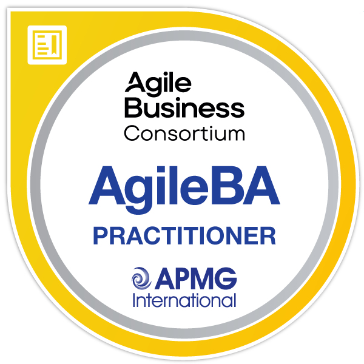
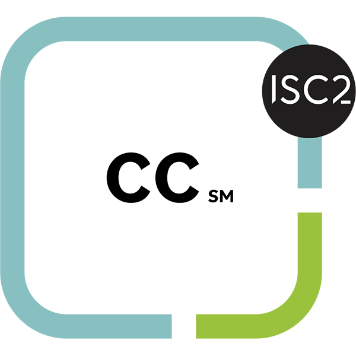

## About

I'm a Business Analyst with approximately 15 years of experience in business analysis and project management across the UK and Australia. My background spans retail systems, ERP, requirements engineering, business process analysis, stakeholder engagement and project delivery.

My primary expertise is in understanding business problems, defining requirements and ensuring that solutions remain aligned with business objectives throughout delivery.

Alongside this experience, I'm developing my capabilities in data analytics, particularly Power BI, data modelling and reporting. I'm interested in how structured business analysis, reliable data and effective governance can improve decision-making and delivery outcomes.

I'm also exploring the practical application of AI-assisted development, using generative AI to support solution implementation while retaining responsibility for requirements, design decisions, testing and validation.

## How I work

My approach combines structured analysis with practical delivery experience:

- Business problem analysis: Understand the underlying problem, business objectives and intended benefits before defining requirements.
- Requirements engineering: Establish clear, traceable requirements, business rules and acceptance criteria.
- Process and data analysis: Understand how business processes, systems and information interact, identifying opportunities for improvement.
- Delivery governance: Maintain visibility of decisions, dependencies, requirements coverage and validation throughout delivery.
- Testing and validation: Use evidence to assess whether solutions meet their intended purpose, rather than relying solely on implementation completion.
- Continuous improvement: Apply lessons learned, automation and emerging technologies where they provide practical value.

## Synapex — Putting analysis into practice

Synapex is my professional portfolio and a practical environment for developing, testing and demonstrating approaches to business analysis, data analytics and solution delivery.

Rather than presenting frameworks and templates in isolation, I use projects to explore real problems, apply structured methods and document the decisions and evidence behind the outcomes.

My published work includes:

- [Azure DevOps Governance Analytics](/projects/azure-devops-governance-analytics/) — Using Power BI to improve visibility of work item health, approval governance and delivery controls.

- [GuitarTabs](/projects/guitar-tabs/) — Applying requirements engineering, iterative delivery, AI-assisted implementation and structured validation to a personal software application.

I also maintain a [Power BI Delivery Framework](/delivery-frameworks/power-bi-end-to-end/) and supporting templates designed to encourage consistent analysis, traceability and validation.

## Current focus

My current interests include strengthening the connection between business requirements, delivery activities and measurable outcomes.

I'm continuing to develop practical examples involving business analysis, delivery governance and data analytics, with an emphasis on solutions that address identifiable problems and provide demonstrable value.

You can explore the work through my project case studies and [Learning & Build Notes.](/build-notes/)

  

    © 2026 Carl Patten. All rights reserved. 
    <a href="mailto:carlpatten@synapex.co.uk">carlpatten@synapex.co.uk</a>
  

  

    

    

    <!--
    
     -->
  

