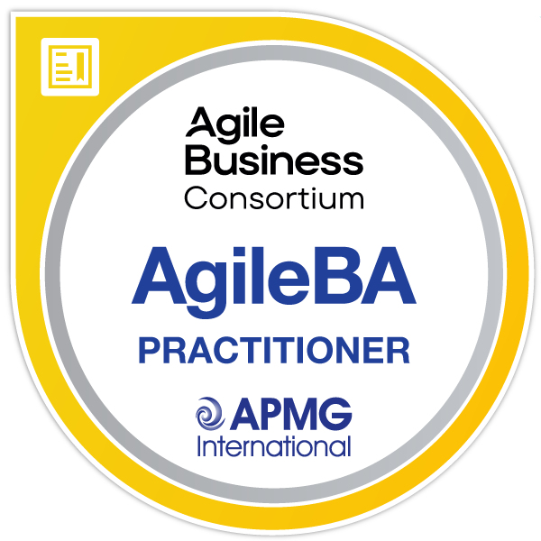
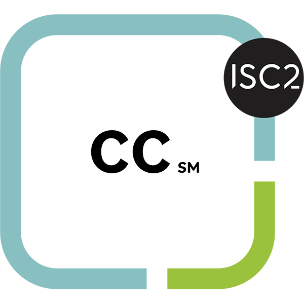

# Learning & Build Notes

These notes explain how I build, organise and improve the work shown in this portfolio. They focus on practical uses of tools and the decisions behind them, rather than general software tutorials.

## GitHub, Markdown and Version Control

I use Git and GitHub to manage changes to my portfolio, project documentation and supporting materials. Markdown provides a straightforward way to maintain structured content, organise case studies and keep supporting evidence accessible.

While developing the GuitarTabs showcase, I introduced a more controlled approach to updating Synapex:

- Created a dedicated Git feature branch to isolate work from the published website.
- Used Visual Studio Code to edit and review Markdown, images and site content.
- Configured a local Jekyll environment to preview pages before publication.
- Used Git commits and GitHub pull requests to review and merge completed changes.
- Verified the GitHub Pages deployment and checked the live website after publication.

Key learning: Separating development from publication allows changes to be tested and reviewed without affecting the live website.

## AI-assisted solution development

GuitarTabs provided an opportunity to explore how generative AI can support the development of a working software application.

I used ChatGPT to help translate requirements into technical approaches, generate implementation code, investigate defects and propose corrections.

My role focused on defining requirements, making design decisions, reviewing proposed solutions, performing functional testing and deciding whether the results met the intended outcomes.

The development process was iterative: requirements and examples were provided, an implementation was generated, the behaviour was tested, and defects or gaps were investigated before accepting changes.

Key learning: AI-assisted development still requires clear requirements, informed decisions, structured validation and an understanding of the limitations of generated solutions. A successful implementation cannot be assumed simply because the code runs.

[View the Guitar Tabs case study →](/projects/guitar-tabs/)

## Testing, validation and regression

The GuitarTabs project demonstrated the importance of testing beyond the initial functionality.

Changes to the rendering of chord diagrams, fingering colours and musical notation sometimes affected previously working layouts. Resolving one issue could introduce another elsewhere.

To manage this, I used representative test files and repeated checks of affected functionality. These included notation alignment, rendering across multiple measures, chord diagrams and print output.

I also used a custom beat-checking utility to identify potential timing inconsistencies in AlphaTex notation.

Key learning: Fixing a defect is not sufficient. Previously working functionality must also be checked, particularly where multiple features share the same rendering or configuration logic.

## Project template and supporting materials

I created an Excel-based project template that applies the Power BI Delivery Framework, together with supporting how-to guides and stakeholder questionnaires.

## Python and repeatable work

I used Python to help generate some of the guides and questionnaires for that template. I review the resulting material against the framework to check that it remains consistent with the source.

## What comes next

I will continue adding focused notes when a project introduces a useful technique, development approach or lesson learned.

The intention is to capture practical experience that can be reused, rather than document every tool or implementation detail.

  

    © 2026 Carl Patten. All rights reserved. 
    <a href="mailto:carlpatten@synapex.co.uk">carlpatten@synapex.co.uk</a>
  

  

    

    

    <!--
    
     -->
  

