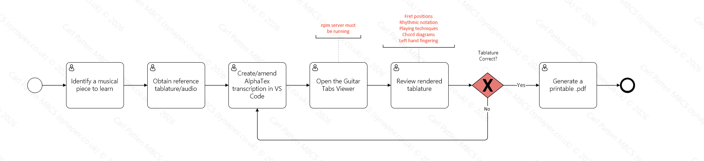
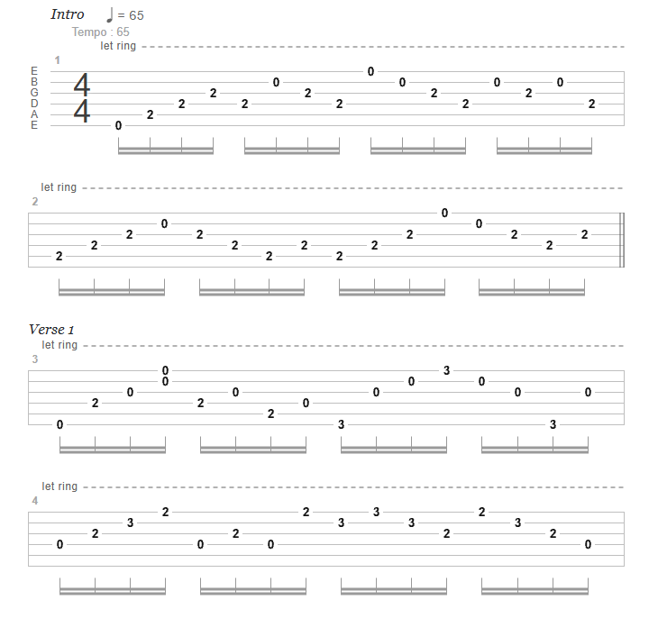
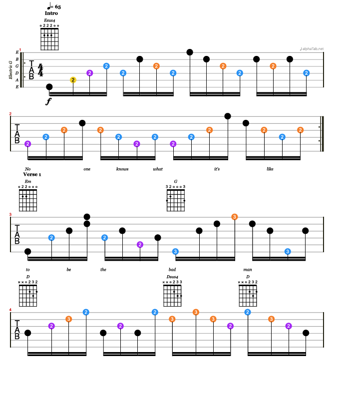

# Business Problem & Requirements

[Home](/) · [Projects](/projects/) · [GuitarTabs](/projects/guitar-tabs/) · **Business Problem & Requirements**

## Business Context

The project originated from a personal requirement to create, maintain and print guitar tablature suitable for independent electric guitar practice.

Existing guitar tablature resources provided access to musical notation but did not offer the required combination of editable TAB, colour-coded fretting-hand finger assignments, chord diagrams and controlled printing.

The objective was not to develop a commercial music application. It was to create a **zero-cost, maintainable personal tool** capable of producing guitar tablature in a format suited to the user's learning and practice requirements.

The project also provided an opportunity to investigate whether AI-assisted development could deliver a working bespoke application without requiring the project owner to possess advanced software development expertise.

## Guitar Tablature Authoring Workflow

The following BPMN process illustrates the workflow used to create, review and print guitar tablature using the GuitarTabs application.

The process begins with selecting a musical piece and obtaining reference material. An AlphaTex transcription is created or amended in VS Code and rendered through the GuitarTabs viewer.

The rendered output is reviewed for musical accuracy, including fret positions, rhythmic notation, playing techniques, chord diagrams and fingering assignments.

Where discrepancies are identified, the transcription is amended and reviewed again. Once the output is acceptable, a printable PDF is generated.

*Figure 1 — GuitarTabs authoring, review and printing workflow.*

## Problem Statement

**How can a guitarist create and maintain editable, finger-coloured guitar tablature, incorporating musical notation and chord diagrams, and reliably produce readable printed scores without relying on paid software or subscriptions?**

The problem had several dimensions:

- **Notation:** Musical information needed to be editable, including fret positions, timing, chords and playing techniques.
- **Visualisation:** Fretting-hand finger assignments needed to be immediately recognisable through consistent colours.
- **Printability:** Rendered notation needed to remain readable and correctly aligned when exported to A4 PDF.
- **Maintainability:** Music files needed to remain editable independently of their rendered output.
- **Cost:** The solution needed to operate without subscription fees or paid hosting.

These needs formed the basis for evaluating the proposed solution and its subsequent iterations.

## The Problem - and the Intended Improvement

The original requirement was to make guitar tablature easier to interpret, annotate and print for independent practice.

The comparison below illustrates the difference between conventional tablature and the enhanced notation provided by GuitarTabs.

### Before - Conventional Guitar Tablature

Conventional tablature communicates fret positions and rhythm but may require additional annotation to identify the intended fretting-hand fingers. Depending on the source, editing and print formatting may also be limited.

### After - GuitarTabs

GuitarTabs adds consistent finger-colour identification while retaining musical timing, chord diagrams and common playing techniques. The editable AlphaTex source also provides control over the notation before generating an A4 PDF.

*Figure 1 — Comparison of conventional tablature and GuitarTabs enhanced notation, using the same original musical example.*

The intended improvement was not to replace standard guitar notation, but to supplement it with visual information that supports learning and independent practice.

## Objectives

| ID | Objective | Intended outcome |
| --- | --- | --- |
| OBJ-01 | Enable editable guitar tablature authoring | Maintain music as reusable, text-based source files |
| OBJ-02 | Improve visibility of fingering | Identify fretting-hand finger assignments through colour |
| OBJ-03 | Support practical guitar notation | Represent rhythm, chords, lyrics and common playing techniques |
| OBJ-04 | Produce reliable printed scores | Generate legible A4 documents with consistent notation positioning |
| OBJ-05 | Maintain a zero-cost personal solution | Avoid recurring software and hosting charges |
| OBJ-06 | Retain control of project assets | Keep music and application source under private version control |

*The identifiers above organise the portfolio presentation; they are not represented as original identifiers from a formally approved requirements baseline.*

## Functional Requirements

The following requirements consolidate the capabilities established during development.

| ID | Requirement | Current outcome |
| --- | --- | --- |
| FR-01 | Author and edit guitar tablature using a text-based format | Delivered — AlphaTex files edited in VS Code |
| FR-02 | Display fretting-hand finger assignments using consistent colours | Delivered — finger-coloured fret numerals and a reusable legend |
| FR-03 | Support musical durations, chords, lyrics and playing techniques | Delivered for supported AlphaTex notation |
| FR-04 | Display inline chord diagrams alongside tablature | Delivered — including customised spacing and alignment |
| FR-05 | Automatically discover and select stored TAB files | Delivered — metadata-based library selection |
| FR-06 | Organise files into distinct music categories | Delivered — full songs, shortened songs and chord-reference documents |
| FR-07 | Produce A4 PDF scores with appropriate presentation | Delivered — song printing, finger legend, title and page numbering |
| FR-08 | Produce standalone printable chord-reference sheets | Delivered — dedicated chord viewer and 12-diagram-per-page printing |
| FR-09 | Support identification of rhythmic errors in authored music | Delivered — command-line beat checker with measure and beat-level reporting |
| FR-10 | Support finger-coloured chord diagrams in song headers | Delivered — verified against the 16 header chords in *Behind Blue Eyes* |
| FR-11 | Support finger-coloured chord reference diagrams seperate from song tabs | Delivered - Verified using a six-chord reference collection containing C, D, E, G Am and Em |

The current application meets these requirements within the tested rendering configurations. Delivery does not imply that every possible musical score or notation variation has been validated.

## Non-Functional Requirements & Constraints

| Area | Requirement or constraint | Approach |
| --- | --- | --- |
| Cost | No paid software, subscription or hosting dependency for the application | Local runtime and freely available development components |
| Usability | TAB should be readable in the browser and when printed | Colour conventions, fingering legend and controlled score layout |
| Maintainability | Avoid unnecessary duplication and song-specific fixes | Shared configuration and reusable alignment functions |
| Portability | Editable music and application source should be recoverable | Text-based source files and Git version control |
| Privacy | Personal transcriptions and application code should not be publicly hosted | Private application repository and local operation |
| Compatibility | Protect tested rendering and printing behaviour | alphaTab 1.9.0 deliberately pinned |
| Output | Support A4 portrait printing | Native song printing and separate chord-reference printing |
| Reliability | Changes must not introduce regressions in existing scores | Representative score tests, regression files and PDF verification |

The application is designed for personal use on a local computer. Public network deployment, user authentication and multi-user operation are outside its intended scope.

## Scope & Prioritisation

Development followed an iterative approach. Requirements were assessed against their practical value, implementation effort and potential effect on the existing working application.

### Delivered Scope

The application currently includes text-based notation authoring, finger-coloured fret numbers, finger-coloured chord diagrams, song and chord-reference viewers, library categorisation, print/PDF functionality, custom chord-spacing corrections and a beat-checking utility.

Technical improvements were incorporated where defects affected the usability or reliability of these capabilities.

### Deferred Scope

**VS Code AlphaTex validation:** Comprehensive live syntax diagnostics were investigated but remain deferred. Any future implementation must be practical to maintain and must not destabilise the pinned rendering environment.

**Lyrics positioning refinements:** Further changes are deferred unless a reproducible issue is identified in an actual score.

### Removed from Scope

**Duration-proportional fret boxes:** An earlier proposal to represent note durations using graphical fret boxes was removed after the existing coloured fret numbers, tails and beams were considered sufficient.

This is an example of scope being reduced when a proposed enhancement no longer provided sufficient additional value.

## Acceptance & Validation Approach

Acceptance was based on the actual behaviour of the application rather than code generation alone.

The main checks included:

1. **Functional behaviour:** Confirming that required notation, colours, diagrams and file-selection capabilities operated as intended.
2. **Visual correctness:** Inspecting rendered scores for overlapping elements, misplaced chord diagrams, clipped notation and inconsistent measure positioning.
3. **Print verification:** Comparing browser rendering and A4 print output, including multi-page scores.
4. **Regression testing:** Rechecking representative compositions after modifications to rendering, layout or printing.
5. **Timing diagnostics:** Using the beat checker to identify measures requiring further review.
6. **Change control:** Retaining working versions through Git commits and protecting the tested alphaTab version.

Examples of validated improvements include universal chord-diagram alignment, corrected horizontal chord spacing, page-number formatting, finger-coloured song-header chords and a fix for lower-staff clipping in scores with multiple voices.

The beat checker is a diagnostic aid and does not establish that a transcription matches the original musical recording.

## Requirements Ownership & AI Collaboration

Requirements and acceptance decisions remained under human control throughout the project.

The project owner identified the problems, defined desired capabilities, evaluated proposed changes, executed tests, reported defects and determined whether the resulting behaviour was acceptable.

ChatGPT supported requirements refinement, proposed technical approaches, generated and revised implementation code, assisted with defect diagnosis and produced supporting documentation and validation utilities.

**The distinction between AI-generated implementation and human evaluation is central to this case study.** Generated code was not treated as proof that a requirement had been satisfied; functionality had to be demonstrated through testing.

The requirements shown here are a retrospective consolidation of the project's documented needs and delivered capabilities, rather than a claim that a formal BRD or approved RTM existed at project initiation.

## Key Business Analysis Lessons

The project reinforced several practical lessons:

- Requirements are more useful when expressed as observable outcomes rather than prescribed technical implementations.
- A working solution may reveal defects and constraints that were not obvious during initial requirements definition.
- Technical feasibility and maintenance costs can justify deferring or removing enhancements.
- Reusable corrections are preferable to accumulating individual workarounds for specific examples.
- Visual inspection and regression testing remain essential when AI is used to generate implementation code.
- The person accepting a solution must understand what has been tested, what remains uncertain and where its limitations lie.

---

[← GuitarTabs Overview](/projects/guitar-tabs/) · [Next: Solution Architecture →](/projects/guitar-tabs/solution-architecture/)

---

© 2026 Carl Patten. All rights reserved.
