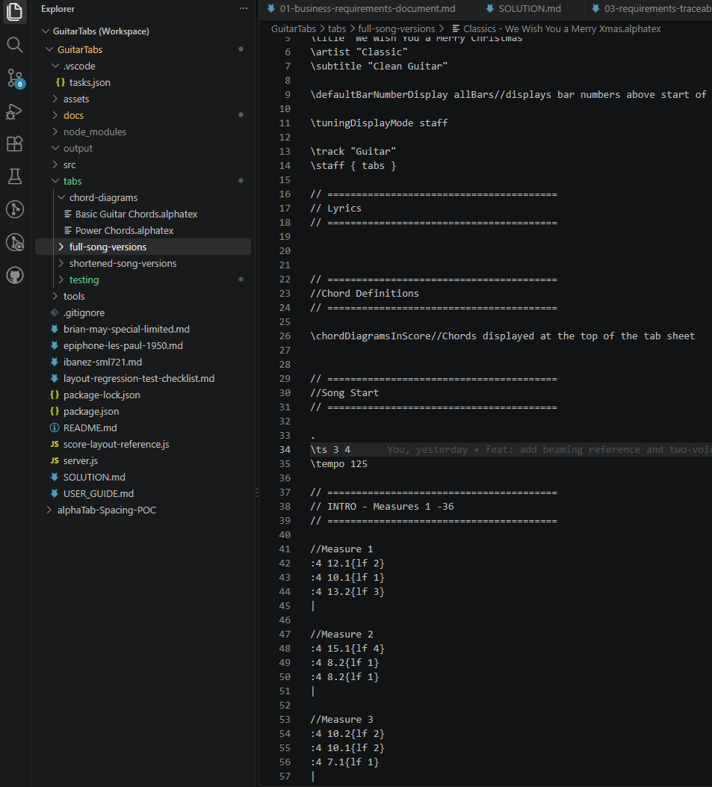
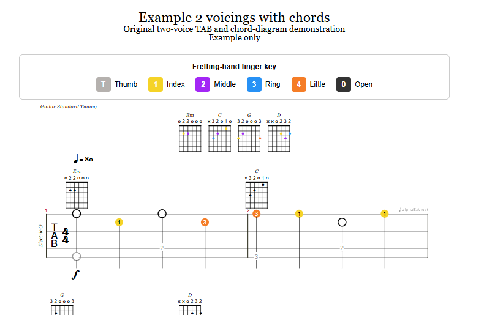
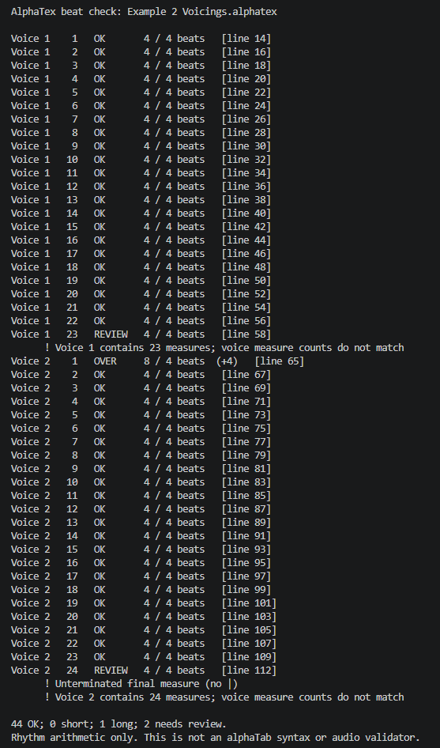

# Implementation

[Home](/) · [Projects](/projects/) · [GuitarTabs](/projects/guitar-tabs/) · **Implementation**

<!-- IMAGE PLACEHOLDERS
     This page includes five numbered figure placeholders in HTML comments.
     They do NOT display or produce broken-image icons until activated.
     To publish a figure: save its image under assets/projects/guitar-tabs/,
     remove the surrounding <!-- and --> from that figure block,
     and review the local Jekyll preview before merging into main.
     Figure 5 is optional and may instead appear on Validation & Testing.
-->

## Implementation Overview

GuitarTabs was delivered incrementally as a **locally hosted, browser-based guitar tablature application**. Rather than building a music notation engine from scratch, the solution uses AlphaTex and alphaTab, extending their behaviour where the standard rendering and printing results did not meet the user requirements.

Development was **AI-assisted**: ChatGPT generated and revised much of the implementation code and supported technical diagnosis. My contribution focused on specifying the required behaviour, selecting among proposed approaches, running changes locally, reporting defects with evidence, testing outputs and deciding whether each iteration was acceptable. The components below describe the implemented solution, **not a claim that I independently wrote every component**.

The implementation can be understood through five connected areas: source and library management; notation and fingering; rendering and layout; printing; and validation.

## 1. AlphaTex Authoring and TAB Library

Scores are written as editable `.alphatex` files in VS Code. These contain the notes, durations, chord references, effects, lyrics and fingering instructions from which the application generates its display and print output.

The Express server discovers source files recursively under the `tabs/` folder and provides their metadata through `GET /api/tabs`. Browser selectors allow the user to choose between **full songs**, **shortened song versions** and **chord-reference documents**. The filename identifies the actual source file, while its AlphaTex metadata supplies the display title and artist.

This design avoids the need for a database. **The AlphaTex file remains the editable source of truth; the PDF is a generated output.**

*Figure 1 — An original AlphaTex score being edited in VS Code and selected in the GuitarTabs viewer.*

## 2. Colour-Coded Fingering and Chord Diagrams

### Fingering in tablature

A core requirement was to distinguish fretting-hand finger assignments without replacing standard fret-number and rhythm notation. The application interprets AlphaTex finger assignments and applies a shared colour convention to the rendered fret numerals. A corresponding legend is presented in the song viewer and printed score; open-string notes remain neutral rather than implying a fretting finger.

Finger colours and labels are maintained centrally in `src/finger-config.js`, so the viewer and print flows use a consistent convention.

### Finger-coloured song-header chords

The project later extended finger colouring to **chord diagrams displayed in song headers**. The implementation was verified against all **16 header chords** in the *Behind Blue Eyes* arrangement, including the viewer, print preview and saved PDF. This enhancement was recorded in Git commit `e79a710`.

**Scope distinction:** Finger-coloured chord dots in song headers are delivered; equivalent automatic per-finger colouring for the **separate chord-reference sheet** is not established as delivered.

<!-- FIGURE 2 — Finger-coloured notation and chord diagrams
     INSERT IMAGE HERE when the original screenshot is ready.
     Suggested filename: assets/projects/guitar-tabs/figure-02-finger-colours-chords.png
     Capture an original progression showing colour-coded fret numerals, the finger legend,
     and finger-coloured song-header chord diagrams.

*Figure 2 — Colour-coded fretting-hand assignments, fingering legend and song-header chord diagrams.*
-->

## 3. Custom Rendering and Universal Chord Alignment

### The problem

In early tests, inline chord diagrams sometimes crowded or overlapped, or appeared at inconsistent heights above the TAB staff. The issue became particularly apparent in measures containing sustained chords and explicit note durations. An initial correction targeted particular opening measures, but did not provide a sustainable solution across different songs.

### The implemented correction

Two complementary approaches were adopted:

| Problem | Implementation | Purpose |
|---|---|---|
| **Insufficient horizontal space** | A customised **alphaTab 1.9.0** renderer sets `contributesToBeatSpacing: true` for the chord effect. | Allows inline chord diagrams to influence beat spacing while the score is laid out. |
| **Inconsistent vertical positioning** | `alignChordDiagramsUniversal()` in `src/score-layout.js` adjusts positions relative to the detected TAB staff. | Replaces song-specific vertical corrections with a reusable layout adjustment. |

The shared layout uses automatic measure wrapping (`barsPerRow: -1`), `scale: 0.7` and a validated `stretchForce: 0.6`. The vertical alignment routine targets approximately **9.33px** clearance and limits corrections to **20px**, subject to its geometry checks. These settings were tested against representative scores but are not guaranteed for every possible notation layout.

The customised build is retained as `src/alphaTab-custom-1.9.0.js`. The underlying alphaTab dependency remains **pinned to version 1.9.0** because changing the rendering engine could invalidate the tested alignment and print behaviour.

The significant outcome was not merely that the diagrams aligned in one song. It was that a **general correction replaced a growing set of song-specific fixes**.

<!-- FIGURE 3 — Chord alignment before and after
     INSERT IMAGE HERE when genuine before/after evidence is available.
     Suggested filename: assets/projects/guitar-tabs/figure-03-chord-alignment-before-after.png
     Use an original regression score. Label the two captures 'Before' and 'After'.
     If no original 'Before' evidence remains, replace this with a labelled
     illustrative comparison; do not claim it is a historical test screenshot.

*Figure 3 — Comparison of the chord-diagram rendering issue and the tested universal alignment correction.*
-->

## 4. Viewer, Printing and Chord References

GuitarTabs provides two distinct output workflows because complete songs and reference sheets require different layouts.

| Workflow | Implemented method | Output |
|---|---|---|
| **Song viewer and printer** | Browser rendering and native alphaTab `api.print()` | A4 TAB score with finger-colour key, chords, annotations, centred song title and page numbering |
| **Chord-reference viewer and printer** | Extracted alphaTab chord graphics arranged using HTML/CSS and `window.print()` | A4 sheets with up to **12 chord diagrams per page**, arranged 3 × 4 |

Using native alphaTab printing for songs resolved problems encountered with an earlier HTML-only print approach. The final song print workflow applies the relevant alignment adjustments to the generated print document, rather than assuming that the on-screen preview automatically matches the PDF.

### Lower-staff / two-voice clipping fix

A later defect caused content extending beneath the TAB staff to be clipped, particularly when a secondary voice was present. The implemented correction adds **90px bottom padding to the song score content box** in the viewing and printing flows. This is separate from alphaTab's `systemPaddingBottom` layout setting.

The fix was verified against existing scores and a dedicated **Two Voice** regression case in the viewer, print preview and saved PDF. It is recorded in commit `6dc60a6`.

<!-- FIGURE 4 — Completed A4 song PDF
     INSERT IMAGE HERE when the demonstration PDF screenshot is ready.
     Suggested filename: assets/projects/guitar-tabs/figure-04-a4-song-pdf.png
     Capture an original score showing centred title, page numbering, finger legend,
     and, if practical, notation with two voices.

*Figure 4 — Completed A4 score showing the printable notation, fingering legend and page presentation.*
-->

## 5. Beat Checker and Timing Diagnostics

Visual correctness does not necessarily establish musical timing correctness. To help review AlphaTex source, the project includes the Node.js utility `tools/beat-checker.js`.

The checker reports measure duration against the time signature, identifies source lines and provides **beat-by-beat and multi-voice diagnostics**. The implementation record also describes an `--all` workflow for checking eligible files. Its findings guide source correction rather than automatically rewriting the music.

For example, a recorded *My Immortal* check flagged measures **6, 7, 9 and 10** as **4.5 beats in 4/4**. Those results identified transcription measures requiring review; they were **not evidence of a failure in the checker**.

The utility does not verify pitch, fret selection, finger choice or whether a transcription matches a recording. Musical review remains necessary.

<!-- FIGURE 5 — Beat checker diagnostics (optional; may move to Validation & Testing)
     INSERT IMAGE HERE if this evidence remains on the Implementation page.
     Suggested filename: assets/projects/guitar-tabs/figure-05-beat-checker-diagnostics.png
     Use a new original demonstration score containing an intentionally overfilled bar
     and corrected timing. Label the output as a controlled example.

*Figure 5 — Command-line beat checker identifying a duration error in a controlled test example.*
-->

## 6. Iterative Defect Investigation

Implementation involved a repeated cycle: reproduce a problem, inspect the result, evaluate an AI-proposed change, run the application again and compare the output against expected behaviour.

| Observed issue | Response | Verification evidence |
|---|---|---|
| Chord diagrams overlap or lack horizontal clearance | Customised chord effect in alphaTab 1.9.0 | Layout regression score and full-song viewer/print checks |
| Chord diagrams or measure numbers shift vertically | Universal alignment and measure-number corrections | Inspected song systems and A4 print preview |
| Layout fixes work in preview but not final PDF | Apply necessary corrections in the native print document | Viewer, preview and PDF comparisons |
| Second voice / bottom staff clipped | Add 90px score-container bottom padding | Dedicated Two Voice regression plus existing scores |
| Incorrect measure durations | Extend command-line beat diagnostics | Reported beat totals and source-line investigation |

The main delivery principle was to **preserve known-good functionality while resolving a specific defect**. Representative music files, print checks and Git history made it possible to detect regressions and retain working implementations.

## 7. Delivery Responsibilities and Controls

**My responsibilities:** Define requirements and acceptance expectations; make scope and design decisions; provide reproducible evidence of defects; run and inspect the application; compare proposed changes with expected results; and accept or reject working increments.

**ChatGPT's responsibilities in the collaboration:** Propose technical approaches; generate and revise much of the JavaScript, HTML and CSS; help analyse rendering behaviour; suggest fixes; and assist with validation utilities and technical documentation.

The project was maintained in a **private GitHub repository**. The public Synapex showcase describes selected engineering decisions and outcomes but does not publish the full source repository or commercial song transcriptions.

## Implementation Outcome

The application now supports editable guitar TAB, automatic file discovery, colour-coded fingering, inline and standalone chord diagrams, controlled A4 printing, a customised rendering engine and rhythm-diagnostic tooling. The most important engineering gains were **reusable alignment**, **consistent viewer-to-print output** and **repeatable regression testing**.

These are delivered and tested capabilities within the recorded configurations, not proof of compatibility with every possible score or claim of independent coding expertise.

---

[← Solution Architecture](/projects/guitar-tabs/solution-architecture/) · [GuitarTabs Overview](/projects/guitar-tabs/) · [Next: Validation & Testing →](/projects/guitar-tabs/validation-and-testing/)

---

© 2026 Carl Patten. All rights reserved.
