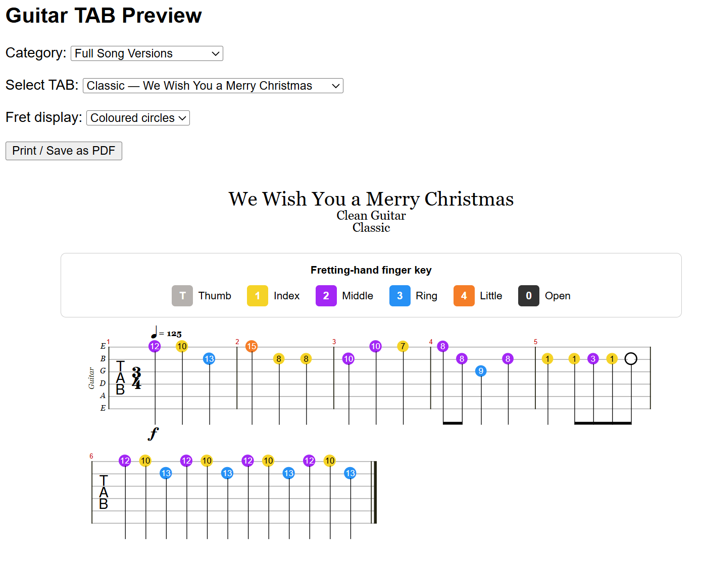

# GuitarTabs — Custom Guitar Tablature Application

[Home](/) · [Projects](/projects/) · **GuitarTabs**

## Project Overview

GuitarTabs is a **bespoke guitar tablature authoring, viewing and printing application**, developed to address limitations encountered when preparing musical notation for personal guitar practice.

The project demonstrates the practical application of **business analysis, solution design, software development and structured testing** to deliver a working application against a defined set of requirements and constraints.

Built using JavaScript, Node.js, Express and a customised alphaTab rendering engine, the solution allows guitar tablature to be authored in AlphaTex, displayed with colour-coded fingering and exported as formatted A4 PDF scores.

The project evolved through iterative development, with technical challenges requiring investigation, root-cause analysis, third-party library customisation and regression testing.

## Development Approach & AI Collaboration

GuitarTabs was developed using an **AI-assisted software development approach**, with ChatGPT acting as the principal coding and technical implementation assistant.

My role focused on defining requirements, evaluating proposed solutions, making design and scope decisions, directing development iterations, testing implemented functionality, identifying defects and accepting completed changes.

ChatGPT was used extensively to generate and revise application code, investigate technical problems, propose solutions and assist with technical documentation.

The application was developed iteratively, with changes tested in the local environment and defects investigated through screenshots, diagnostic output, regression testing and repeated verification.

**This project is presented as evidence of requirements engineering, solution ownership, AI-assisted delivery, analytical problem-solving and testing — rather than a claim of independent expertise in every programming language or technology used.**

## Solution Preview

The completed application provides a browser-based guitar tablature viewer, chord-reference library, finger-coloured notation and printable scores.

## Explore the Project

Follow the development of GuitarTabs from requirements definition through solution architecture, implementation, validation and delivery.

1. [Business Problem & Requirements](business-problem-and-requirements/)
2. [Solution Architecture](solution-architecture/)
3. [Implementation](implementation/)
4. [Validation & Testing](validation-and-testing/)
5. [Outcome & Lessons Learned](outcome-and-lessons-learned/)

## What This Project Demonstrates

- Identifying and defining user requirements and solution constraints
- Assessing existing software capabilities against functional requirements
- Designing a locally hosted application architecture
- Directing and validating AI-assisted JavaScript implementation
- Evaluating and testing third-party software integration and customisation
- Identifying defects and using diagnostic evidence to support root-cause investigation
- Assessing and validating reusable technical solutions
- Defining validation requirements and testing AI-generated utilities
- Applying regression testing to protect existing functionality
- Maintaining technical documentation, source control and recovery procedures
- Managing incremental delivery and technical changes

## Solution Technology Stack

| Tool / Technology | Use in the Project |
|---|---|
| **VS Code** | AlphaTex authoring, JavaScript development and debugging |
| **JavaScript** | Application logic, rendering adjustments and validation utilities |
| **Node.js** | Local JavaScript runtime and command-line tooling |
| **Express** | Local web server and automatic discovery of tablature files |
| **AlphaTex** | Text-based musical notation and fingering assignments |
| **alphaTab 1.9.0** | Musical notation parsing, rendering and native printing |
| **Custom alphaTab renderer** | Enhanced horizontal spacing for inline chord diagrams |
| **HTML / CSS / SVG** | Browser interfaces, graphical corrections and print formatting |
| **Git / GitHub** | Private version control, change history and recovery |
| **Markdown** | Solution documentation and portfolio case study |

## Portfolio Evidence

The case study will include evidence of:

- Business problem definition, requirements and constraints
- Solution architecture and component responsibilities
- Browser-based guitar tablature and chord-reference interfaces
- Colour-coded fingering and chord-diagram rendering
- Custom alphaTab rendering modifications
- Structured defect investigation and resolution
- Beat validation and regression testing
- Printable A4 score generation
- Delivery outcomes and lessons learned

Public demonstration material will be original and will not disclose copyrighted song transcriptions or private repository contents.

## Project Outcome

GuitarTabs has progressed from a requirement for colour-coded guitar tablature into a **functioning, locally hosted application** supporting editable notation, chord diagrams, fingering visualisation, validation and controlled printing.

The solution demonstrates how requirements-led development, technical investigation and repeatable testing can be combined to deliver and progressively improve a bespoke software application.

The application remains under active development, with potential enhancements assessed against the stability of the existing implementation.

---

[Home](/) · [Projects](/projects/) · **GuitarTabs**

---

© 2026 Carl Patten. All rights reserved.
