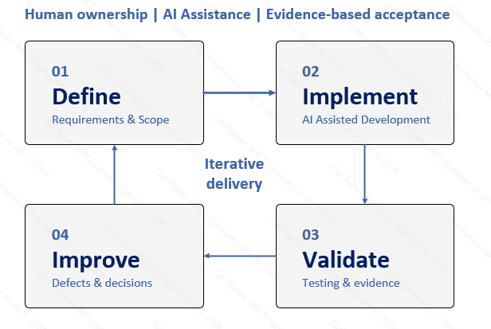

# Outcome & Lessons Learned

[Home](/) · [Projects](/projects/) · [GuitarTabs](/projects/guitar-tabs/) · **Outcome & Lessons Learned**

## Project Outcome

GuitarTabs progressed from a personal need for **editable, finger-coloured guitar tablature** to a functioning, locally hosted authoring, viewing, validation and printing application.

The project demonstrates **AI-assisted solution delivery**, with my role focused on defining the problem, selecting and prioritising capabilities, directing development, evaluating design options, testing outputs, reporting defects and deciding whether results were acceptable. ChatGPT provided substantial coding and technical implementation assistance.

The outcome is an application that I use to prepare tablature in AlphaTex, view the rendered notation and produce printable scores. It is **a personal tool under continued development**, not a commercial product or a claim of independently engineered software.

## Outcomes Against the Original Objectives

The following table relates the delivered solution to the objectives documented in the [Business Problem & Requirements](../business-problem-and-requirements/) case study. The objective identifiers are retrospective portfolio labels, not a claim of a formally approved project baseline.

| Objective | Observed outcome | Assessment |
| --- | --- | --- |
| **OBJ-01 — Editable notation** | Musical source is retained in `.alphatex` files, edited in VS Code and rendered when selected. | Delivered |
| **OBJ-02 — Visible fingering** | Fretting-hand finger colours and a reusable legend appear in the viewer and song print output. | Delivered for tested notation |
| **OBJ-03 — Practical guitar notation** | Rhythm, chords, lyrics and supported techniques are represented; multi-voice rendering has a dedicated regression test. | Delivered within tested support |
| **OBJ-04 — Printable scores** | A4 song PDFs include the score, finger legend, centred title and page numbering; chord-reference sheets use a separate print workflow. | Delivered within tested print environment |
| **OBJ-05 — Zero recurring application cost** | The solution uses a local server and development tools without requiring paid hosting or an application subscription. | Achieved for this personal setup |
| **OBJ-06 — Control of source** | Application code and editable notation are maintained in a private Git repository; generated PDFs are derived outputs. | Delivered |

This is a **qualitative acceptance summary**, based on documented local tests and use. The project did not establish quantitative time savings, learning gains, financial return or formal user-satisfaction measures.

## Additional Capabilities Delivered Through Iteration

Not every valuable feature was apparent at the outset. Testing and use of increasingly complex scores led to improvements beyond the original finger-colouring requirement:

- **Library organisation:** Recursive discovery and separate categories for full songs, shortened versions and chord-reference files.
- **Reusable score layout:** Shared rendering configuration and universal chord-diagram alignment, replacing earlier song-specific corrections.
- **Custom rendering:** A modified alphaTab 1.9.0 build allows inline chord diagrams to contribute to horizontal beat spacing.
- **Chord-header finger colouring:** Colour assignments verified for all 16 song-header chords in a representative arrangement; separate chord-reference sheets remain a distinct capability.
- **More reliable printing:** Native song PDF generation, custom page presentation and corrected chord-reference pagination.
- **Timing diagnostics:** A command-line beat checker with measure, source-line and beat-by-beat reporting to help identify transcription durations requiring review.
- **Regression protection:** Dedicated layout and two-voice test material, used alongside longer scores and PDF inspection.

These improvements illustrate how requirements and acceptance criteria can evolve through actual use, provided changes are tested against previously working behaviour.

## Key Delivery Decisions

| Decision | Reasoning and result |
| --- | --- |
| **Use AlphaTex as editable source** | Retains control of notation independently of a PDF or proprietary document. |
| **Build around alphaTab rather than create a music engraving engine** | Reuses established notation functionality while focusing development on the required visual and print behaviour. |
| **Maintain two distinct print workflows** | Full-song native printing and standalone chord-reference sheets have different layout needs. |
| **Replace specific chord fixes with a reusable correction** | Reduced dependence on individual songs or measure numbers and supported regression testing across multiple scores. |
| **Pin alphaTab at 1.9.0** | Protects a known-working custom renderer and SVG-dependent adjustments from untested dependency changes. |
| **Remove duration-proportional fret boxes** | Existing fret numbers with rhythmic tails and beams met the learning need without additional visual complexity. |
| **Defer live VS Code AlphaTex validation** | No acceptable low-maintenance implementation was established within the pinned environment. |

A consistent principle was to **avoid adding complexity without a demonstrable user benefit**.

## An Iterative, Evidence-Led Delivery Approach

The project followed an iterative approach in which requirements,
AI-assisted implementation, testing and improvement informed
successive development decisions.

*Figure 1 — GuitarTabs delivery learning cycle, illustrating human
solution ownership, AI-assisted implementation and evidence-based
acceptance.*

## Lessons Learned

### 1. Requirements need to describe observable behaviour

The useful requirement was not “build a guitar application in JavaScript”. It was the ability to **author, inspect and print a readable score with clear fingering information**. Keeping the focus on the desired behaviour allowed technical approaches to change without losing sight of the need.

### 2. AI accelerates implementation but does not establish correctness

ChatGPT generated and revised much of the code and helped investigate technical issues. That did not remove the need to examine results. Several iterations appeared satisfactory in one view but exposed defects in another. **Acceptance required human review of the actual application and generated output.**

### 3. A working preview is not the same as a working deliverable

The browser viewer, print-page preview and final PDF are related but separate outputs. Differences between them made **PDF inspection an explicit validation activity**, rather than assuming successful on-screen rendering guaranteed acceptable printing.

### 4. Narrow fixes can create maintenance problems

Early chord-diagram adjustments addressed specific passages. The more maintainable solution combined custom horizontal spacing with a shared universal vertical alignment routine. This required additional regression work, but reduced reliance on one-off measure-specific fixes.

### 5. Regression tests are especially valuable in visual software

Changes affecting SVG geometry, staff placement or printing could impact features unrelated to the original defect. Purpose-built regression scores, representative full-song tests and a retained known-good Git history helped identify unwanted changes.

### 6. Deferring or removing work is also a delivery decision

Some proposed improvements did not justify their complexity. Duration-based fret boxes were removed from scope; live AlphaTex validation and additional lyrics positioning refinements were deferred. These choices preserved attention on capabilities that materially improved the application.

## What I Would Do Differently

If beginning a similar project again, I would:

1. **Create a small set of representative test scores earlier**, including chord-heavy, multi-voice and multi-page examples, rather than relying initially on individual songs.
2. **Record acceptance criteria alongside each major capability** so a change can be checked systematically in the viewer, print preview and PDF.
3. **Separate the reusable technical test evidence from copyrighted practice material** from the outset, making public portfolio publication easier.
4. **Keep the implementation and decision history connected**, documenting why an approach was adopted, replaced or abandoned without reproducing every troubleshooting exchange.

These are retrospective improvements, not claims that the project followed a formal enterprise delivery framework.

## Limitations and Outstanding Work

GuitarTabs has been validated in its documented local environment, not across every browser, score type or musical notation variation.

- The custom renderer and layout corrections depend on **alphaTab 1.9.0** and the SVG structures used by that version. An upgrade would need separate investigation and regression testing.
- The universal chord alignment has tested clearance and adjustment limits; unusual diagrams or different layouts may still require review.
- **Song-header** chord dots support finger colouring;
- **standalone chord-reference sheets** supports finger colouring.
- The beat checker detects duration-related issues; it does **not** verify pitch, fingering or transcription accuracy against a recording.
- Live AlphaTex syntax diagnostics in VS Code remain deferred. Additional lyrics-layout changes will be considered only if a reproducible issue is found.
- The local Express application is designed for personal use, **not internet-facing or multi-user deployment**.

Future changes should be driven by an identified user need and tested against the existing regression material. The working renderer remains pinned unless a deliberate upgrade is justified.

## Professional Reflection — AI-Assisted Delivery

GuitarTabs is not presented as proof that I am an expert JavaScript developer or that I independently authored its components. It is evidence of a different capability: **taking ownership of a problem and using AI-assisted implementation while retaining responsibility for requirements, decisions, verification and acceptance**.

The most transferable skills from this work are requirements definition, challenging proposed solutions, diagnosing observed problems with evidence, managing scope, identifying regression risk and communicating what has — and has not — been validated.

That distinction matters because the credibility of an AI-assisted project depends not just on what the software can do, but on whether the person presenting it can explain **why it was built, how they evaluated it and where its limitations lie**.

## Conclusion

The project delivered a useful personal application while demonstrating an iterative, evidence-led approach to AI-assisted technology delivery. The principal success was not simply generating code; it was turning a defined learning need into a working solution, identifying problems in real outputs and accepting changes only after practical validation.

The GuitarTabs source repository remains private. Public showcase material will use original demonstration scores, appropriate screenshots and sanitised technical evidence.

---

[← Validation & Testing](/projects/guitar-tabs/validation-and-testing/) · [GuitarTabs Overview](/projects/guitar-tabs/) · [Projects](/projects/)

---

© 2026 Carl Patten. All rights reserved.
