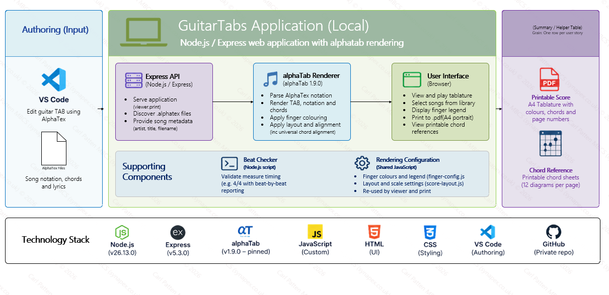

# Solution Architecture

[Home](/) · [Projects](/projects/) · [GuitarTabs](/projects/guitar-tabs/) · **Solution Architecture**

## Architecture Overview

GuitarTabs is a **locally hosted, browser-based guitar tablature application**. Musical scores are maintained as editable AlphaTex text files, discovered by a lightweight Node.js/Express server and rendered in the browser using a customised build of **alphaTab 1.9.0**.

The solution deliberately avoids a database, external hosting service and paid subscription. Its key architectural separation is between **music source files**, **application and rendering logic**, and **derived browser/PDF output**.

The implementation was developed with substantial assistance from ChatGPT. My responsibilities centred on defining the required behaviour, evaluating approaches and trade-offs, directing changes, testing results and accepting or rejecting the implemented solution. The technology descriptions below explain **what the application uses**, not a claim that I independently coded every component.

## High-Level Solution Architecture

*Figure 1 — Component flow. Source files remain authoritative; PDFs are derived outputs.*

## Architectural Components

| Component | Responsibility |
| --- | --- |
| **AlphaTex (`tabs/**/*.alphatex`)** | Editable source of songs and chord-reference definitions, including notes, durations, technique annotations and fingering assignments. |
| **VS Code** | Text editing, local testing and project maintenance. |
| **`server.js` (Node.js/Express)** | Serves the application locally and exposes `GET /api/tabs` for recursive file discovery. |
| **`src/viewer.html`** | Song library selection and rendered tablature preview. |
| **`src/print.html`** | Song print preview and native alphaTab PDF printing. |
| **`src/finger-config.js`** | Shared finger labels and colours used by the song views and their legend. |
| **`src/score-layout.js`** | Shared layout settings, measure alignment, TAB staff detection and universal chord-diagram positioning. |
| **`src/alphaTab-custom-1.9.0.js`** | Customised renderer that gives inline chord diagrams a role in horizontal beat spacing. |
| **`src/chord-viewer.html` / `src/chord-print.html`** | Dedicated chord-reference viewing and A4 printing. |
| **`src/chord-layout.js`** | Extracts and sizes individual chord graphics for the chord-reference workflow. |
| **`tools/beat-checker.js`** | Command-line timing diagnostics, including per-measure, beat-by-beat and multi-voice checks. |
| **Private GitHub repository** | Version control and recovery of source code, score files and documentation; not the application's runtime host. |

## How the Application Works

### 1. Source authoring and file discovery

The user writes or edits a `.alphatex` file in VS Code. Songs are organised under `tabs/full-song-versions/` or `tabs/shortened-song-versions/`; standalone chord references use `tabs/chord-diagrams/`.

The local Express server discovers `.alphatex` files recursively. Its `GET /api/tabs` endpoint supplies filenames, titles, artists and categories, which populate the browser selectors. **No database is required**: the music files and their embedded metadata form the source of truth.

### 2. Browser rendering and finger colours

After a score is selected, the song viewer loads the AlphaTex source and passes it to alphaTab for rendering. Finger assignments in the score are used to style fret numerals and generate a consistent colour legend. Open strings are represented separately rather than assigned a fretting-hand finger colour.

The rendering configuration is shared between the song viewer and song printer to reduce layout differences. Song-header chord diagrams also support finger-coloured dots; this was verified with 16 chords in the *Behind Blue Eyes* arrangement. The separate chord-reference sheets offer equivalent automatic per-finger dot colouring.

### 3. Custom chord spacing and alignment

A significant technical issue was that chord diagrams could crowd or overlap, particularly with different note durations and chord arrangements. The implemented solution combines two mechanisms:

- **Horizontal spacing:** a customised alphaTab 1.9.0 build adds `contributesToBeatSpacing: true` to the chord effect, allowing diagrams to affect beat spacing during layout.
- **Vertical positioning:** `alignChordDiagramsUniversal()` in `score-layout.js` adjusts rendered diagram positions relative to the detected TAB staff, replacing earlier song-specific corrections.

The shared layout uses automatic bars per row (`barsPerRow: -1`), a validated `scale` of `0.7` and `stretchForce` of `0.6`. These are **tested configuration choices**, not guarantees for every score or rendering variation. The customised alphaTab version is deliberately pinned to **1.9.0** to protect the verified behaviour.

### 4. Two different printing paths

**Complete songs** use alphaTab's native `api.print()` flow. The print process incorporates the finger legend, chord/measure corrections and custom page title and numbering. An additional **90px bottom padding** in song score containers addresses a tested case of lower-staff and secondary-voice clipping.

**Chord-reference sheets** use a different route: the application extracts individual chord graphics from an alphaTab-rendered source, arranges them in HTML/CSS and prints using `window.print()`. The tested A4 layout places up to **12 chord diagrams per page**, in three columns and four rows.

These printing paths are intentionally separate because they produce different types of output. A shared HTML print approach previously created problems with song chord positioning.

### 5. Timing validation

The standalone Node.js beat checker inspects AlphaTex measures and reports timing results for review. It supports beat-by-beat breakdown, source-line references, multi-voice analysis and processing all eligible files using `--all`.

This tool helps identify rhythm inconsistencies but **does not prove that the transcription matches the reference recording**. Visual and musical review remain necessary.

## Key Architecture Decisions

| Decision | Rationale and trade-off |
| --- | --- |
| **Local browser application** | Meets the personal-use and zero-hosting-cost requirements; requires a local Node.js server while in use. |
| **AlphaTex as source of truth** | Human-editable and suitable for Git; authoring still requires learning notation syntax. |
| **Express file catalogue rather than database** | Simplifies deployment and maintenance for a small personal library; not designed for multi-user data management. |
| **Shared song layout and colour configuration** | Reduces duplication between preview and print; remains coupled to the tested alphaTab rendering behaviour. |
| **Custom alphaTab 1.9.0 renderer** | Resolves demonstrated chord-spacing limitations; introduces an intentional maintenance responsibility for a customised third-party build. |
| **Universal alignment instead of song-specific fixes** | More reusable and easier to regression-test; still relies on assumptions about generated SVG and staff geometry. |
| **Separate song and chord-reference print paths** | Supports both full-score native printing and compact chord-sheet layouts without forcing one mechanism to serve incompatible outputs. |
| **Private source repository** | Supports versioning and recovery while keeping personal song transcriptions outside the public Synapex portfolio. |

## Operational Boundaries and Maintenance

The server is intended to run on **`127.0.0.1:8080`**, not as a publicly exposed website. Its static-file configuration is appropriate only within this local-use boundary and is **not a production authentication or hosting design**.

There are also known technical constraints:

- The layout adjustments rely on alphaTab **1.9.0** and its generated SVG structure; renderer upgrades require controlled regression testing.
- The universal diagram correction uses detected TAB staff geometry and will not necessarily handle every unusual score.
- The live VS Code AlphaTex language-server validation enhancement remains deferred.
- The PDF and browser output are derived artefacts; the editable AlphaTex files remain authoritative.

## Architectural Validation

Architecture changes were tested using a dedicated layout regression score and representative arrangements, including *Zombie* and *Behind Blue Eyes*. Checks included chord spacing, notation alignment, lyrics, measure numbers, multiple voices and final PDF output.

Examples of verified changes include the universal chord alignment, the customised renderer, song-header chord fingering and the 90px clipping repair. The tests establish behaviour **in the examined cases**; they do not amount to exhaustive compatibility certification.

Public portfolio material will use original or suitably sanitised examples rather than publishing private copyrighted song transcriptions.

## AI-Assisted Implementation and Accountability

ChatGPT generated and revised substantial parts of the JavaScript, HTML, CSS and renderer modification under the project owner's direction. The project owner defined the required outcomes, selected or rejected approaches, ran the application, supplied evidence of defects, tested proposed fixes and confirmed acceptance.

This architecture is therefore presented as evidence of **requirements-led solution ownership, architecture evaluation, AI-assisted delivery and verification**, rather than independent mastery of the entire technology stack.

---

[← Business Problem & Requirements](/projects/guitar-tabs/business-problem-and-requirements/) · [GuitarTabs Overview](/projects/guitar-tabs/) · [Next: Implementation →](/projects/guitar-tabs/implementation/)

---

© 2026 Carl Patten. All rights reserved.
