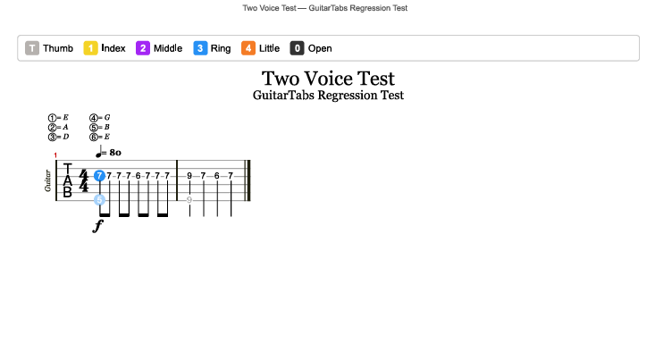
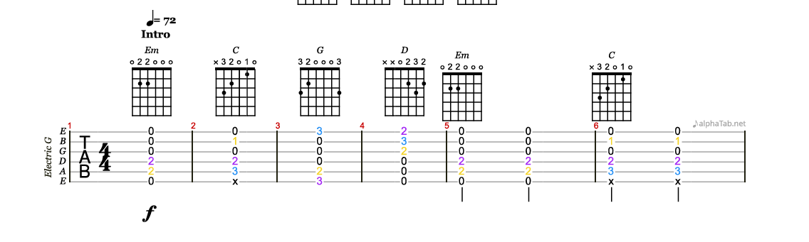
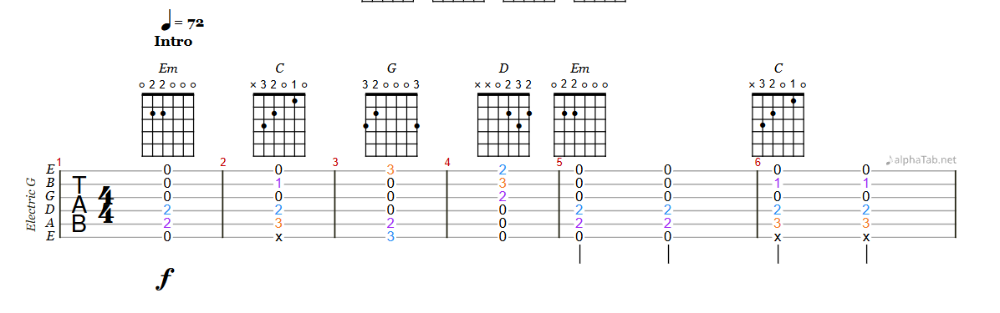
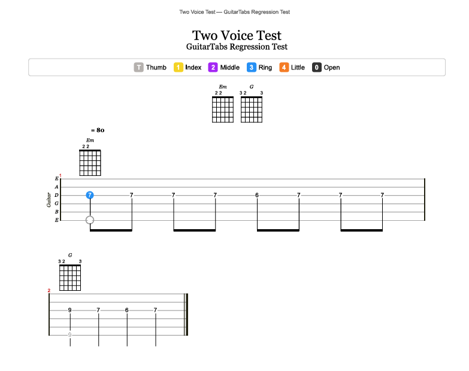
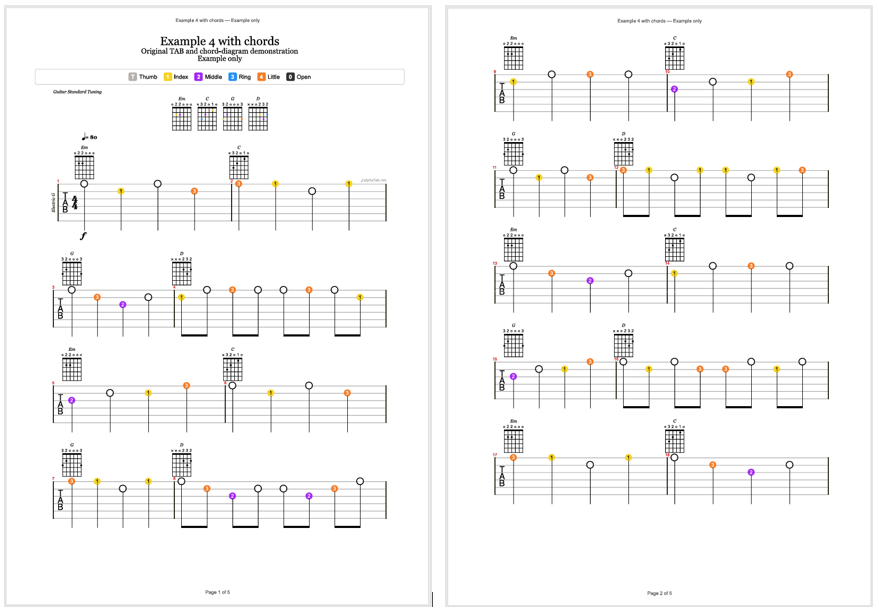

# Validation & Testing

[Home](/) · [Projects](/projects/) · [GuitarTabs](/projects/guitar-tabs/) · **Validation & Testing**

## Validation Approach

GuitarTabs was developed iteratively with ChatGPT assisting with implementation and technical diagnosis. The generated code was not treated as proof of successful delivery. **I evaluated the application against the intended behaviour**, ran local tests, supplied screenshots and diagnostic observations, reported failures, and rechecked results after revisions.

Testing was **practical and risk-based**, not a formal enterprise test programme. The evidence includes dedicated AlphaTex regression scores, browser previews, PDF outputs, command-line diagnostics and Git history. The cases below summarise the observed results recorded during development; they are not claims of exhaustive test coverage.

The validation focus was to establish that:

- TAB notes, fingering colours, chord diagrams, lyrics and annotations rendered legibly.
- Layout corrections worked across different measures and songs, rather than only one example.
- The viewer, print-page preview and final PDF produced compatible results.
- Chord-reference sheets contained the intended number of diagrams without blank pages.
- A dedicated timing checker highlighted measures requiring attention.
- Changes preserved previously working behaviour.

## Test Environments and Evidence

| Area | Tested approach |
|---|---|
| Local application | Node.js / Express server and browser-based song and chord-reference viewers |
| Notation engine | Custom alphaTab **1.9.0** renderer; version deliberately pinned |
| Test material | Layout regression file, Two Voice regression test, techniques test and working song arrangements |
| Visual verification | Viewer and print-page preview, including SVG positioning and annotation checks |
| Output verification | A4 PDF output, layout, colour legend, title, page numbering and pagination |
| Timing validation | `tools/beat-checker.js` against `.alphatex` source |
| Change record | Git commits, documented fixes and repeated regression checks |



*Figure 1 — A purpose-built AlphaTex regression score used to assess rendering behaviour independently of a commercial transcription.*

## Defect Investigation 1 — Chord Spacing and Alignment

### Observed problem

Inline chord diagrams could become crowded, overlap, or appear at inconsistent vertical positions. Earlier corrections targeted particular passages, including the opening measures of *Zombie*, but a song-specific approach was not maintainable.

### Investigation and correction

The solution combined two distinct changes:

- **Horizontal spacing:** A customised alphaTab 1.9.0 build added `contributesToBeatSpacing: true` to the chord effect configuration so chord diagrams could influence layout spacing.
- **Vertical alignment:** A shared `alignChordDiagramsUniversal()` routine adjusted diagram positions against detected TAB staff geometry. It replaced the previous song-specific alignment functions.

The layout regression work also established a need to protect measure numbers and other annotations. The recorded configuration uses `scale: 0.7` and `stretchForce: 0.6`; the universal correction targets approximately 9.33px staff clearance with a 20px maximum vertical adjustment.

### Recorded validation

- A **24-measure Layout Regression Test** passed visual review in the viewer and A4 print preview.
- *Zombie* was rechecked after removal of the legacy correction functions. Measure 80 needed a **16.9px** vertical correction; raising the permitted maximum to **20px** resolved the observed problem.
- *Behind Blue Eyes* was reviewed for visible regressions in chords, lyrics, headings and measure numbering.
- The customised renderer's compiled file was checked against the separate source build using **SHA-256 hashes** on 18 November 2026.

**Outcome:** The tested layouts no longer depended on hard-coded song-specific chord corrections. This does not establish universal compatibility with every alphaTab score or future renderer version.




*Figure 2 — A reproducible chord-layout defect compared with the corrected rendering, using the same score passage.*

## Defect Investigation 2 — Multi-Voice and Bottom-Staff Clipping

### Observed problem

In scores containing multiple voices, content extending beneath the bottom TAB staff could be clipped in the display or printing flow.

### Correction and verification

A **90px bottom padding** adjustment was added to the relevant song score containers. This is distinct from alphaTab's internal `systemPaddingBottom` setting.

The dedicated **Two Voice Test** was used to assess the correction. The solution record confirms that the test and all current tabs passed in the viewer, print-page preview and saved PDF after the change. The repair is recorded in commit `6dc60a6` (21 November 2026).

**Outcome:** The observed lower-staff clipping issue was resolved in the tested configurations, with a repeatable regression example retained for future layout changes.

<!-- FIGURE 3 — Two Voice regression evidence
     Suggested filename: assets/projects/guitar-tabs/validation-figure-03-two-voice-clipping.png
     Earlier screenshots from 18 and 21 November show the Two Voice Test.
     Use a confirmed defective/corrected pair only if the exact states can be established.
     Otherwise show the corrected regression score with a factual caption.



*Figure 3 — The dedicated Two Voice regression score used when validating the bottom-staff clipping fix.*
-->

## Defect Investigation 3 — Printing and Pagination

The final PDF is a separate output that needs checking even when the browser preview appears correct. Early song-printing experiments exposed alignment and presentation differences, including displaced chord diagrams and browser-generated headers. The final song workflow uses native alphaTab printing, with the finger key and custom title/page-number styling incorporated into the generated print document.

Chord-reference printing uses a **different** HTML/CSS-based workflow. Testing documented a specific pagination defect: a 16-chord collection rendered as 12 + 4 diagrams but initially produced two additional blank pages. A later version corrected the output to **two A4 pages**, with no extras. A six-chord reference sheet also printed on one page.

| Test | Recorded result |
|---|---|
| Song PDF with chord/layout corrections | *Zombie* and *Behind Blue Eyes* print outputs visually checked |
| Song title and page numbers | Centred metadata header and custom page numbering confirmed in Chrome output |
| Chord-reference sheet: 6 diagrams | One A4 page |
| Chord-reference sheet: 16 diagrams, failing version | Two content pages plus **two blank pages** |
| Chord-reference sheet: 16 diagrams, corrected version | **Two pages**, arranged 12 + 4, with no blanks |

**Outcome:** PDF validation was treated as an independent acceptance check, not inferred from successful rendering in the browser.

<!-- FIGURE 4 — A4 PDF pagination evidence
     Suggested filename: assets/projects/guitar-tabs/validation-figure-04-print-pagination.png
     Prefer the original chord-reference regression sheet showing 12 + 4 across two pages,
     or a non-copyrighted test-score PDF demonstrating the header, legend and pagination.



*Figure 4 — Print verification demonstrating predictable A4 pagination and readable output.*
-->

## Functional Verification — Finger Colouring and File Discovery

The application uses a shared fretting-hand colour convention across song preview and print output. A later enhancement applied colours to the dots in **song-header chord diagrams**; all **16 header chords** in the tested *Behind Blue Eyes* arrangement were checked in the viewer, print preview and saved PDF (commit `e79a710`, 20 November 2026).

File discovery was also checked after moving AlphaTex sources into category folders. A full song loaded and printed from `full-song-versions`; the techniques test worked from `shortened-song-versions`; the chord viewer displayed only items in `chord-diagrams`.

**Scope boundary:** The successful song-header chord colouring does not establish equivalent per-finger dot colouring in the separate chord-reference print workflow.

## AlphaTex Beat Checker — Timing Diagnostics

A command-line utility, `tools/beat-checker.js`, was created to help identify measures whose durations do not match the expected time signature. The documented capabilities include measure and source-line reporting, **beat-by-beat breakdown**, multi-voice handling and an `--all` workflow.

The utility can be run from the GuitarTabs project root, for example:

```powershell
node tools/beat-checker.js "tabs/full-song-versions/Artist - Title.alphatex"
```

A recorded check of *My Immortal* showed measures **6, 7, 9 and 10** containing **4.5 beats in 4/4**, which prompted transcription review. These findings do not imply the checker was broken: it identified source measures needing attention.

The checker supports **rhythmic completeness**, not musical accuracy. It cannot establish that notes, fret positions, fingerings or the interpretation match a reference recording.

<!-- FIGURE 5 — Beat checker output
     Suggested filename: assets/projects/guitar-tabs/validation-figure-05-beat-checker.png
     Run the checker against an ORIGINAL purpose-built AlphaTex test file showing
     both an OK measure and an intentionally overfull measure, with beat breakdown.
     Avoid publishing transcriptions of commercial songs.


*Figure 5 — Measure-level and beat-by-beat diagnostics identifying source timing errors for review.*
-->

## Regression Test Summary

| Area | Evidence-supported outcome | Limitation |
|---|---|---|
| Custom chord renderer | Horizontal-spacing behaviour reviewed in the viewer and A4 print preview | Different scales and unusual diagrams not exhaustively tested |
| Universal chord alignment | 24-measure regression file, *Zombie* and *Behind Blue Eyes* reviewed | Depends on alphaTab 1.9.0 SVG structure |
| Two-voice rendering | Dedicated regression and existing tabs passed after 90px padding correction | Recheck after future layout or pagination changes |
| Song printing | Headers, legend, page numbers and layout verified in Chrome/PDF | Other browsers not guaranteed identical |
| Chord-reference printing | Six-chord and 16-chord sheets checked; blank-page issue corrected | 12 diagrams per page is a tested default |
| Song-header chord colouring | 16 chords verified in viewer, print preview and PDF | Standalone chord-reference dots are distinct |
| Beat checking | Overfull measures identified with source/beat diagnostics | Does not validate pitch or transcription correctness |

## Testing Responsibilities and Lessons

My contribution was to **specify what acceptable output should look like**, test the application, report observed defects and decide whether fixes met the intended outcome. ChatGPT assisted with the code, suggested technical explanations and proposed corrections. Neither AI-generated code nor a successful build was sufficient evidence of acceptance on its own.

The main lessons were:

- Check the **generated PDF**, not only the browser preview.
- Use small, purpose-built regression scores to isolate rendering defects.
- Repeat tests on representative longer scores after shared layout changes.
- Prefer reusable corrections over narrow fixes for one song or measure.
- Distinguish a tool's **diagnostic findings** from proof that all source music is correct.
- Record limitations and preserve a known-good version before altering a pinned renderer.

This evidence supports the project's role as an **AI-assisted delivery and validation case study**, rather than a claim of independently authored production software or comprehensive testing across every possible notation scenario.

---

[← Implementation](/projects/guitar-tabs/implementation/) · [Next: Outcome & Lessons Learned →](/projects/guitar-tabs/outcome-and-lessons-learned/)

---

© 2026 Carl Patten. All rights reserved.
