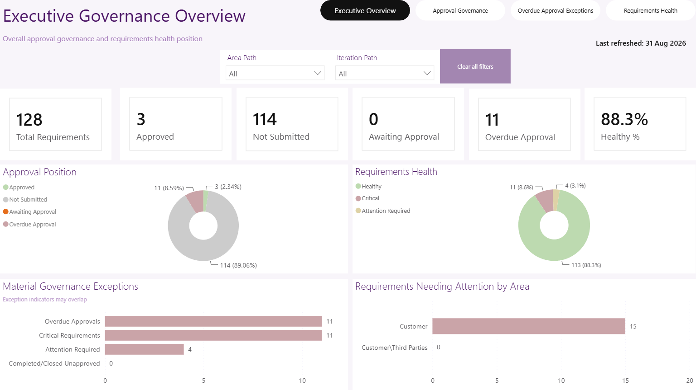
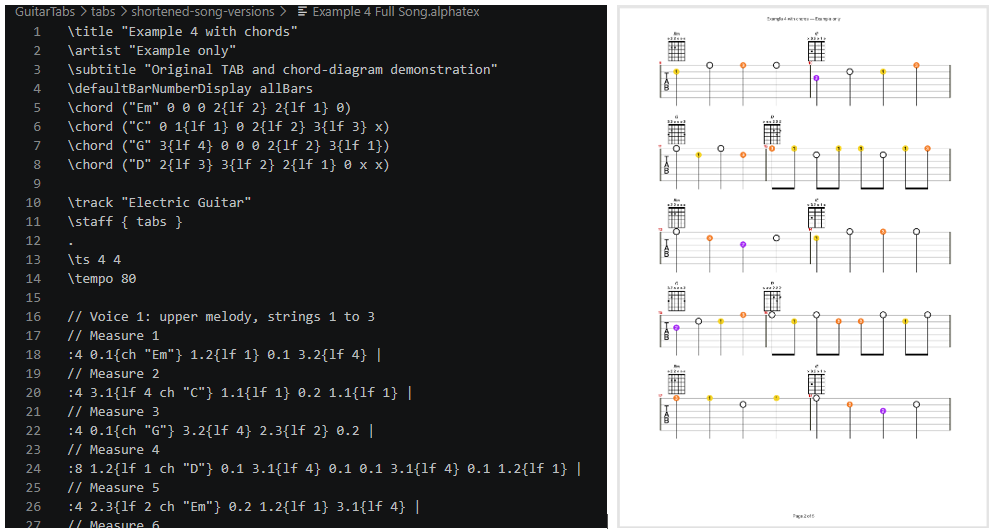
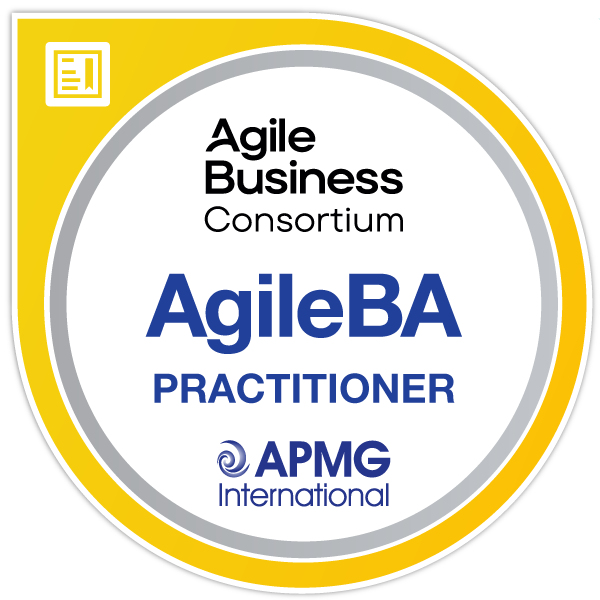
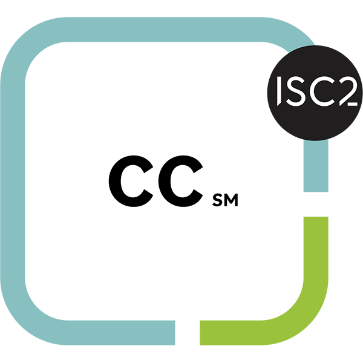

# Projects

Selected end-to-end case studies demonstrating practical capability across Business Analysis, Data Analytics and technology delivery.

## Data & Analytics

### Azure DevOps Governance Analytics

A practical end-to-end analytics project using Azure DevOps data to provide approval-governance and requirements-health reporting in Power BI.

**Business problem:** Approval requests could remain outstanding without clear management visibility of how long they had been waiting or who was responsible for action.

**Solution:** A Power BI analytics solution using Azure DevOps current and historical data to identify approval exceptions, assess requirements health and provide executive governance visibility.

**Skills demonstrated:**
Power BI · Power Query · DAX · Semantic Modelling · Data Analysis · Business Analysis · Requirements Engineering · BPMN · Azure DevOps · Validation & Testing

[View the full case study →](/projects/azure-devops-governance-analytics/)

## Software Development & AI-Assisted Delivery

### GuitarTabs — Custom Guitar Tablature Application

_AlphaTex source and rendered two-voice guitar tablature with colour-coded fingering_

A bespoke guitar tablature authoring, visualisation and printing application developed through AI-assisted software development, requirements-led solution design and structured validation.

**Business problem:** Existing guitar tablature tools did not provide the required combination of editable notation, colour-coded fingering, chord diagrams and reliable A4 printing within a zero-cost personal solution.

**Solution:** A locally hosted application using Node.js, Express, AlphaTex and a customised alphaTab renderer. The solution supports editable guitar notation, finger-coloured fret numbers and chord diagrams, automated beat validation and formatted PDF output.

**Development approach:** Requirements, solution decisions, testing and acceptance were directed by the project owner, with ChatGPT providing substantial code generation, technical implementation and troubleshooting support.

**Skills demonstrated:** Requirements Engineering · Solution Design · AI-Assisted Development · Technical Problem-Solving · Defect Investigation · Validation & Testing · Regression Testing · Git

[View the full case study →](/projects/guitar-tabs/)

  

    © 2026 Carl Patten. All rights reserved. 
    <a href="mailto:carlpatten@synapex.co.uk">carlpatten@synapex.co.uk</a>
  

  

    

    

    <!--
    
     -->
  

